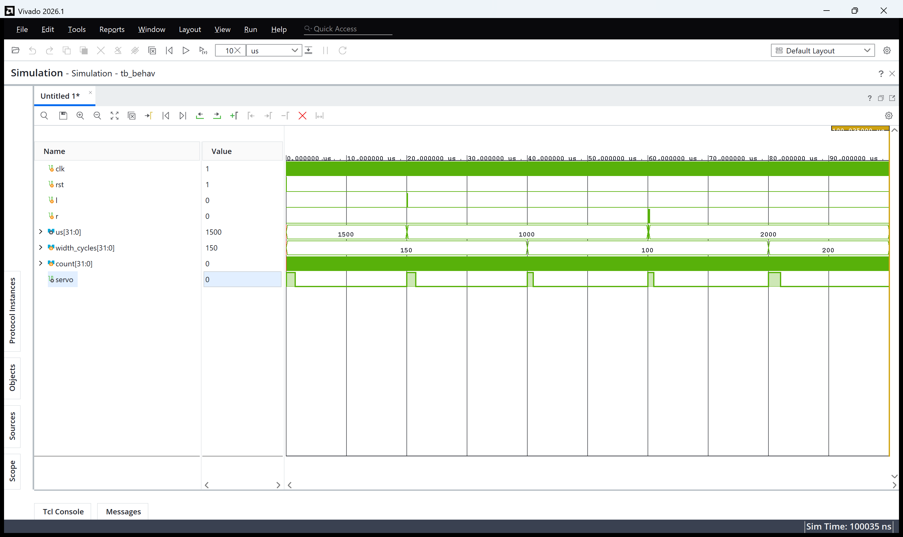
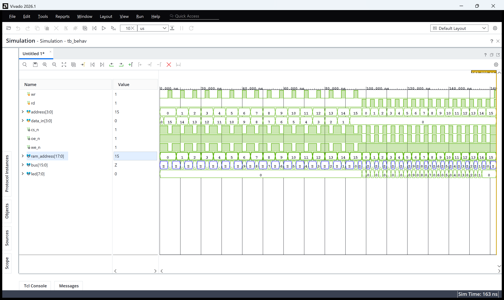
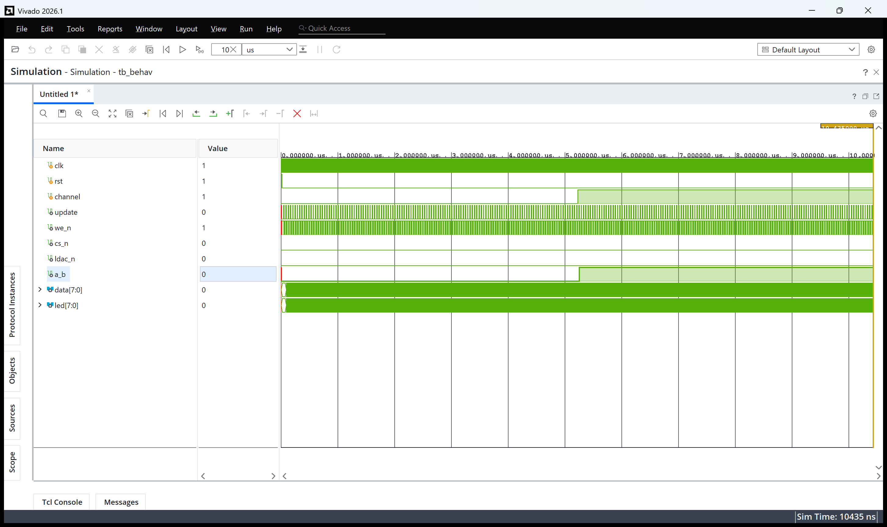
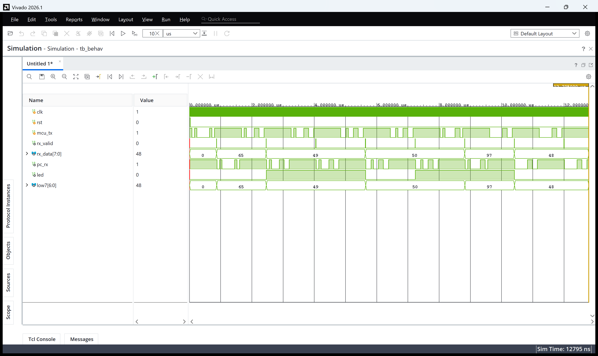

# 실험 후 레포트: 서보모터 제어, SRAM 읽기·쓰기, DAC (STM32_2 FPGA 교재 실습)

작성일 2026-11-01. 실험일 2026-10-26.

[실험 전 레포트](../pre/01_servo_sram_dac.md) · [Vivado 빌드 스크립트](../../tools/vivado_build.tcl) · [파형 캡처 스크립트](../../tools/capture_vivado_wave.ps1)

## Vivado GUI 과정과 사전 결과 비교

Vivado 2026.1에서 설계별로 `servo_ctrl`, `sram`, `dac`, `uart_cmd` 네 프로젝트를 만들었습니다. 타깃 부품은 Spartan-7 `xc7s75fgga484-1`입니다. 프로젝트 생성과 소스 등록은 [tools/vivado_build.tcl](../../tools/vivado_build.tcl)로 수행하고, 생성된 `vivado/<설계>/<설계>.xpr`를 GUI로 열어 보드 다운로드를 진행했습니다.

| 구분 | 서보모터 | SRAM | DAC | UART 명령 (STM32_2 과제6·7) |
|---|---|---|---|---|
| Design Sources | `servo_position.v`, `servo_pwm.v`, `servo_ctrl.v`, `servo_board.v`, `button_onepulse.v` | `sram_bus_control.v`, `sram.v` | `ramp8.v`, `dac_parallel8.v`, `dac.v` | `uart.v`, `uart_cmd.v` |
| Simulation Sources | `tb_servo_ctrl.sv` | `tb_sram.sv` | `tb_dac.sv` | `tb_uart_cmd.sv` |
| Constraints | [servo_ctrl.xdc](../../constraints/servo_ctrl.xdc) | [sram.xdc](../../constraints/sram.xdc) | [dac.xdc](../../constraints/dac.xdc) | [uart_cmd.xdc](../../constraints/uart_cmd.xdc) |
| 설계 최상위 | `servo_board` | `sram` | `dac` | `uart_cmd` |
| 시뮬레이션 최상위 | `tb` | `tb` | `tb` | `tb` |

서보는 버튼을 한 클록 펄스로 바꾸는 디바운스 회로와 현재 폭 LED 표시를 넣은 보드용 최상위 `servo_board`를 사용했습니다. 핀은 장비 교재의 실습 25(서보, p.467~468), SRAM 핀 구성표(p.603·610), 실습 35(DAC, p.625) 표를 따랐습니다.

Vivado Simulator(XSim)로 행동 시뮬레이션을 실행한 결과는 다음과 같습니다.

| 설계 | Vivado XSim 로그 | 종료 시각 | VS Code (Icarus Verilog) 사전 결과 |
|---|---|---|---|
| 서보모터 | [`PASS servo: 20ms frame, 1/1.5/2ms pulse, limits, reset`](../../evidence/vivado/servo_ctrl_simulation.log) | 100,036 ns | [동일 PASS](../../evidence/vscode/servo_ctrl_sim_log.txt), 100,036 ns |
| SRAM | [`PASS SRAM: 16 addresses, bus release, simultaneous request`](../../evidence/vivado/sram_simulation.log) | 164 ns | [동일 PASS](../../evidence/vscode/sram_sim_log.txt), 164 ns |
| DAC | [`PASS DAC: 260 writes, wraparound, channel, data hold, reset`](../../evidence/vivado/dac_simulation.log) | 10,436 ns | [동일 PASS](../../evidence/vscode/dac_sim_log.txt), 10,436 ns |
| UART 명령 | [`PASS UART_CMD: 8 echoes, LED 0/1/2 commands, other chars hold`](../../evidence/vivado/uart_cmd_simulation.log) | 12,796 ns | [동일 PASS](../../evidence/vscode/uart_cmd_sim_log.txt), 12,796 ns |

네 설계 모두 두 시뮬레이터의 PASS 메시지와 `$finish` 시각이 같았습니다.

### Vivado 파형 해석

Vivado 파형 창의 값은 10진수(unsigned)로 표시했고, `$finish` 직전 시각까지 실행한 화면입니다.

- `us`가 1500 → 1000 → 2000으로 바뀌는 시점(왼쪽 8번, 오른쪽 15번 버튼 펄스)보다 `width_cycles`가 150 → 100 → 200으로 바뀌는 시점이 늦습니다. 폭은 20 µs(시뮬레이션 기준 한 프레임) 경계에서만 갱신되어 펄스가 중간에 잘리지 않습니다.
- `servo` 펄스 폭이 프레임마다 150, 100, 200클록으로 달라집니다(보드에서는 1.5, 1, 2 ms).

- 앞 절반(쓰기)에서 `wr`가 1일 때마다 `cs_n`·`we_n`이 0이 되고 버스에 `data_in` 15, 14, …, 0이 실립니다. `wr`가 0이면 버스는 Z입니다.
- 뒤 절반(읽기)에서 `rd`가 1일 때 `cs_n`·`oe_n`이 0이 되고 SRAM 모델이 저장값을 버스에 내보내 `led`가 15, 14, …로 바뀝니다. 마지막 동시 요청 구간에서는 버스가 Z로 남습니다.

- `update`가 4클록마다 1이 되고 그 다음 클록에 `we_n`이 한 클록 LOW가 되어, 10.4 µs 동안 260번 씁니다. `data`와 `led`가 같은 값으로 0~255를 반복합니다.
- 중간에 `channel`이 1로 바뀌면 다음 쓰기부터 `a_b`가 1이 됩니다. `cs_n`·`ldac_n`은 계속 0입니다.

- `mcu_tx`로 들어온 문자마다 `rx_valid`가 한 클록 1이 되고 `rx_data`가 65('A'), 49('1'), 50('2'), 97('a'), 48('0')로 바뀝니다. 같은 문자가 `pc_rx`로 다시 나갑니다.
- `led`는 '1'에서 켜지고, '2'를 두 번 받으며 꺼짐 → 켜짐으로 반전되며, 'a'에서는 유지되고 '0'에서 꺼집니다.

## 합성·구현·bit

Run Synthesis → Run Implementation → Generate Bitstream을 실행해 네 설계 모두 `write_bitstream completed successfully`를 확인했습니다.

| 설계 | 생성 파일 | SHA-256 | WNS / WHS | Slice LUT | 레지스터 | 사용 IOB |
|---|---|---|---|---:|---:|---:|
| 서보 | [servo_board.bit](../../evidence/vivado/servo_board.bit) · [빌드 로그](../../evidence/vivado/servo_ctrl_build.log) | `9bd4b15c…a47c7d85` | +0.370 / +0.122 ns | 857 | 121 | 13 |
| SRAM | [sram.bit](../../evidence/vivado/sram.bit) · [빌드 로그](../../evidence/vivado/sram_build.log) | `8195d7b2…50c87496` | 클록 없음 | 4 | 0 | 55 |
| DAC | [dac.bit](../../evidence/vivado/dac.bit) · [빌드 로그](../../evidence/vivado/dac_build.log) | `3921843e…23b434c4` | +14.225 / +0.191 ns | 19 | 58 | 23 |
| UART 명령 | [uart_cmd.bit](../../evidence/vivado/uart_cmd.bit) · [빌드 로그](../../evidence/vivado/uart_cmd_build.log) | `0a0d5f4f…2b2ad0cb` | +14.832 / +0.160 ns | 136 | 118 | 12 |

- **서보 타이밍**: WNS가 +0.370 ns로 다른 설계보다 작습니다. `servo_pwm`의 `pulse_us × 50 / 1000`(32비트 곱셈·나눗셈)과 LED 표시용 `pulse_us / 100` 나눗셈이 조합회로로 합성되어 LUT 857개와 긴 경로가 생겼기 때문입니다. 여유는 양수라 50 MHz에서 동작하며, 폭을 클록 수로 바로 저장(1 µs = 50클록 상수 곱)하면 크게 줄일 수 있습니다.
- **SRAM**: 클록이 없는 조합회로라 타이밍 경로가 없습니다. 사용하지 않는 주소 상위 14비트와 LED 상위 4비트가 0으로 고정되어 합성 경고(`Synth 8-3917`)가 나오며 동작에는 영향이 없습니다.
- **DAC**: `dac_csn`·`dac_ldacn`을 항상 0으로 두어 같은 상수 경고가 나옵니다.
- **공통 경고**: DRC `CFGBVS-1`(Bank 0 전압 속성 미지정)은 이전 실험과 같은 이유로 남겨 두었습니다.
- **핀 배치에서 확인한 점**: 교재 서보 실습 표에는 출력이 `A22`, 핀 구성표에는 `AA22`로 서로 달라 `AA22`를 사용했고 보드에서 서보가 동작했습니다. DAC 실습 표의 `clk = N8`은 키패드 SW_2 핀이라 메인 클록 `B6`을 사용했습니다.

## 보드 기록·촬영 상태

Combo II-DLD S75 보드에서 클록 스위치를 F(50 MHz), KEYPADS SEL을 Button Switch로 두고, Hardware Manager의 Auto Connect로 `xc7s75`에 각 비트스트림을 다운로드했습니다.

### 서보모터 (`servo_board.bit`)

[서보 시연 영상](../../evidence/board/servo_demo.mp4)

| 조작 | 기대 동작 | 관찰 결과 | 사진 |
|---|---|---|---|
| SW_2 (리셋) | 중앙 1.5 ms, LED 0000_1111 | 서보 암이 중앙에 위치 | [중앙](../../evidence/board/photos/servo_start.jpg) |
| SW_1 / SW_3 반복 | 0.1 ms씩 한쪽으로 회전, 1 ms·2 ms에서 정지 | 누를 때마다 암이 한 단계씩 돌아가고 반대 버튼으로 되돌아옴 | [한쪽](../../evidence/board/photos/servo_turned.jpg) · [반대쪽](../../evidence/board/photos/servo_other_side.jpg) |

- 디바운스 회로 덕분에 버튼을 한 번 누르면 한 단계만 움직였고, 길게 눌러도 끝까지 튀어 가지 않았습니다.

### SRAM (`sram.bit`)

[SRAM 시연 영상](../../evidence/board/SRAM_demo.mp4)

| 조작 | 관찰 결과 | 사진 |
|---|---|---|
| DIP1~4로 주소, DIP5~8로 데이터를 정하고 SW_1(쓰기) | 쓰는 동안 LED 0 (쓰기 중에는 읽기 출력 없음) | [쓰기](../../evidence/board/photos/sram_write.jpg) |
| 주소를 바꿔 SW_2(읽기)를 누르는 동안 | 해당 주소에 써 둔 값이 LED5~LED8에 표시 (예: LED5·LED7 = 0101 = 5) | [읽기](../../evidence/board/photos/sram_read.jpg) |

- 여러 주소에 서로 다른 값을 쓴 뒤 다시 읽었을 때 주소마다 써 둔 값이 그대로 나와, 외부 SRAM에 저장되고 읽기 때 FPGA가 버스를 놓는 동작이 확인되었습니다.

### DAC (`dac.bit`)

[DAC 시연 영상](../../evidence/board/DAC_demo.mp4)

| 조작 | 관찰 결과 | 사진 |
|---|---|---|
| 다운로드 후 | LED1~LED8이 이진수로 계속 증가 (예: 1011_1111 = 191), 보드의 VOLTAGE METER 막대가 DAC 출력 전압에 따라 늘었다 줄었다 반복 | [카운트·전압계](../../evidence/board/photos/dac_count.jpg) |
| DIP_SW1(채널 선택) 변경 | 출력 채널이 바뀌어 전압계 표시가 달라짐 | [채널 전환](../../evidence/board/photos/dac_channel.jpg) |

- 전압계 막대가 LED 값(0~255)에 비례해 늘어나다 255 → 0에서 처음으로 돌아가는 모습이 반복되어, 8비트 값이 아날로그 전압의 톱니파로 변환됨을 확인했습니다.

### UART 명령 (`uart_cmd.bit`, STM32_2 과제6·7)

MCU 쪽 결과는 [stm32_lab 실험 후 레포트](https://github.com/yuminsang0815/stm32_lab/blob/main/reports/post/STM32_2_task5_task6_task7.md)에 정리했습니다. MCU PC10 → 확장 포트 BDIO_00(F8), GND 공통으로 연결하고, MCU가 보낸 문자 `0`, `1`, `2`, `A`가 FPGA USB-UART(COM5)로 그대로 출력되었습니다.

## 결론

STM32_2 주차 FPGA 실습 세 가지(서보 PWM, 외부 SRAM 버스, 8비트 병렬 DAC)와 MCU 과제용 UART 명령 회로를 VS Code Icarus Verilog와 Vivado XSim에서 같은 PASS 결과로 검증하고, 교재 핀 표를 바탕으로 XDC를 작성해 비트스트림을 생성한 뒤 Combo II-DLD S75 보드에서 시연했습니다. 버튼에 따른 서보 각도 변경, 주소별 SRAM 저장·읽기, DAC 출력에 따른 전압계 톱니 변화와 채널 전환을 확인했습니다. 교재 핀 표끼리 서로 다른 값(서보 A22/AA22, DAC 클록 N8/B6)은 핀 구성표와 보드 구조로 판단해 바로잡았고, 서보는 곱셈·나눗셈 조합회로 때문에 타이밍 여유가 작아 개선 방향을 정리했습니다.
