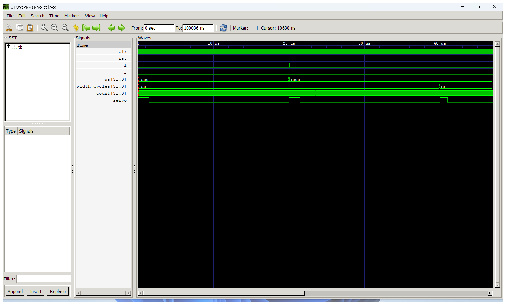
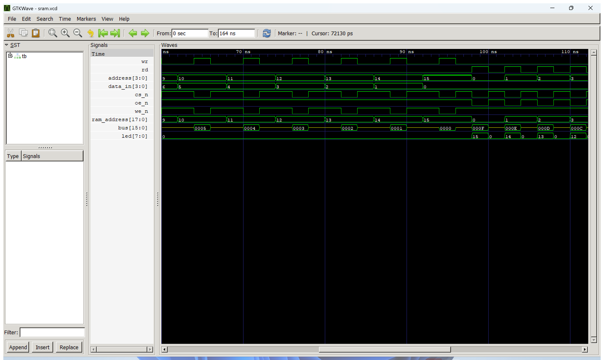
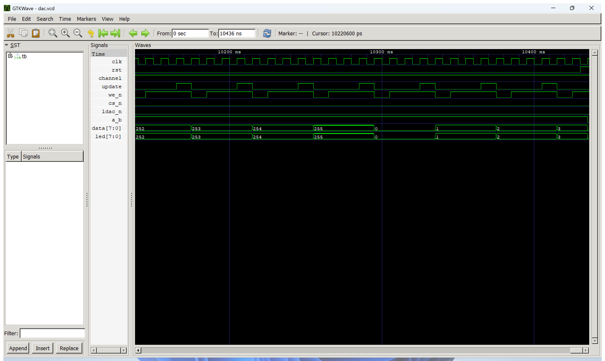
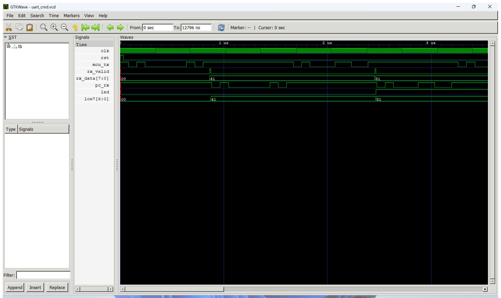

# 실험 전 레포트: 서보모터 제어, SRAM 읽기·쓰기, DAC (STM32_2 FPGA 교재 실습)

작성일 2026-10-23.

## 1. 목적과 핵심 파라미터 계산

### 실험 목적
STM32_2 주차의 FPGA 교재 실습으로, FPGA에서 외부 장치를 제어하는 세 회로를 설계하고 검증한다.
- **서보모터 제어(`servo_ctrl`)**: 20 ms 주기마다 1~2 ms 폭의 HIGH 펄스를 내보내 서보 각도를 정한다. 버튼을 누를 때마다 폭을 0.1 ms씩 줄이거나 늘린다. `servo_position`이 폭(µs)을, `servo_pwm`이 펄스를 만든다.
- **SRAM 읽기·쓰기(`sram`)**: 외부 비동기 SRAM에 주소(0~15)와 4비트 데이터를 써 두었다가 같은 주소에서 읽어 LED에 표시한다. `sram_bus_control`이 CS·OE·WE 제어선과 양방향 데이터 버스의 방향을 정한다.
- **DAC(`dac`)**: 8비트 병렬 DAC에 0 → 255로 1씩 증가하는 값을 일정 간격으로 써서 톱니파 전압을 만든다. `ramp8`이 값과 쓰기 시점을, `dac_parallel8`이 데이터 버스와 쓰기 펄스를 만든다.

또한 STM32_2 과제6·7을 위해 MCU가 UART3(PC10)로 보낸 바이트를 받아 PC로 되돌려 보내고 `'0'`·`'1'`·`'2'` 명령으로 LED를 제어하는 **FPGA 수신 회로(`uart_cmd`)**를 Lab3 UART 에코의 송수신 모듈로 작성했다.

### 핵심 파라미터 계산
1. **서보 PWM (`servo_pwm`)**:
   - 프레임 클록 수: $\text{FRAME\_CYCLES} = f_{\mathrm{clk}} / 50 = 50{,}000{,}000 / 50 = 1{,}000{,}000$ (20 ms)
   - 펄스 폭 클록 수: $\text{width\_cycles} = \text{pulse\_us} \times (f_{\mathrm{clk}}/1000) / 1000 = \text{pulse\_us} \times 50$

   | pulse_us | 보드 width_cycles | 시뮬레이션 (`CLK_HZ = 100,000`) | 듀티 |
   |---:|---:|---:|---:|
   | 1000 (최소) | 50,000 | 100 | 5.0% |
   | 1500 (리셋값, 중앙) | 75,000 | 150 | 7.5% |
   | 2000 (최대) | 100,000 | 200 | 10.0% |

   - 시뮬레이션에서는 한 프레임이 $100{,}000/50 = 2{,}000$클록(20 µs)이다.
   - 폭은 프레임 경계에서만 바뀌므로 펄스가 중간에 잘리지 않고, 버튼을 누른 다음 프레임부터 새 폭이 적용된다.
   - `left_pulse`·`right_pulse`는 버튼 한 번당 **한 클록 펄스**여야 한다. 버튼을 그대로 연결하면 누르고 있는 동안 매 클록 0.1 ms씩 바뀌어 곧바로 끝까지 가므로, 보드용 최상위 `servo_board`에 Lab3의 `button_onepulse`(2단 동기화 + 20 ms 디바운스)를 넣었다.

2. **SRAM 버스 제어 (`sram_bus_control`, 제어선은 LOW 활성)**:

   | ctrl_w | ctrl_r | 동작 | ram_cs | ram_oe | ram_we | 데이터 버스 | LED |
   |:---:|:---:|---|:---:|:---:|:---:|---|---|
   | 0 | 0 | 대기 | 1 | 1 | 1 | Z (놓음) | 0 |
   | 1 | 0 | 쓰기 | 0 | 1 | 0 | FPGA가 `{12'b0, data_in}` 구동 | 0 |
   | 0 | 1 | 읽기 | 0 | 0 | 1 | Z, SRAM이 구동 | `ram_data[3:0]` |
   | 1 | 1 | 무시 | 1 | 1 | 1 | Z | 0 |

   - 읽을 때 FPGA가 버스를 놓지 않으면 SRAM 출력과 충돌하므로 `16'bz`로 둔다. 주소는 18비트 중 하위 4비트만 쓴다(`{14'b0, address}`).

3. **DAC 갱신 (`ramp8`, `dac_parallel8`)**:
   - 갱신 간격: $\text{UPDATE\_CYCLES} / f_{\mathrm{clk}} = 500{,}000 / 50\text{ MHz} = 10\text{ ms}$
   - 톱니파 한 주기: $256 \times 10\text{ ms} = 2.56\text{ s}$ (약 0.39 Hz). 255 다음 0으로 돌아간다.
   - 쓰기 펄스 `we_n`은 한 클록(20 ns) LOW이고, 데이터는 펄스 동안 유지된다. `cs_n`·`ldac_n`은 항상 0이라 쓰는 즉시 출력이 갱신된다.
   - 기준 전압을 $V_{\mathrm{REF}}$라 하면 1 LSB는 $V_{\mathrm{REF}}/256$이다. 실제 DAC의 최소 쓰기 폭과 출력 전압 범위는 교재 장치 설명으로 확인한다.

4. **MCU → FPGA UART (`uart_cmd`)**:
   - 9600 bps 분주: $\text{DIV} = \lfloor (50{,}000{,}000 + 4{,}800) / 9{,}600 \rfloor = 5{,}208$클록, 실제 9,600.6 bps(오차 +0.006%).
   - 한 문자(시작 1 + 데이터 8 + 정지 1 = 10비트)는 약 1.04 ms. 받은 바이트를 그대로 USB-UART(F6)로 보내 PC에서 비교한다.
   - 명령: `'0'`(0x30) 끄기, `'1'`(0x31) 켜기, `'2'`(0x32) 반전, 그 밖의 문자 유지.

---

## 2. 파일 구성과 역할

| 경로 | 파일명 | 역할 및 설명 |
|---|---|---|
| `servo_ctrl/` | `servo_position.v` | 버튼 펄스로 펄스 폭 1000~2000 µs를 100 µs씩 변경, 동시 입력 무시 |
| `servo_ctrl/` | `servo_pwm.v` | 20 ms 프레임 카운터와 폭 비교로 서보 펄스 생성, 폭은 프레임 경계에서만 갱신 |
| `servo_ctrl/` | `servo_ctrl.v` | 교재 설계 최상위(위 두 모듈 연결) |
| `servo_ctrl/` | `servo_board.v`, `button_onepulse.v` | 보드용 최상위. 키패드 버튼 디바운스 후 한 클록 펄스, 현재 폭을 LED에 0.1 ms 단위로 표시 |
| `servo_ctrl/` | `tb_servo_ctrl.sv` | `CLK_HZ = 100,000`으로 프레임 길이, 1/1.5/2 ms 폭, 한계, 동시 입력, 리셋 검사 |
| `sram/` | `sram_bus_control.v` | 읽기·쓰기 요청을 CS·OE·WE와 버스 방향으로 변환 |
| `sram/` | `sram.v` | 설계 최상위. 주소·데이터 연결, 읽은 값 하위 4비트를 LED로 |
| `sram/` | `tb_sram.sv` | 비동기 SRAM 모델과 16개 주소 쓰기·읽기, 버스 해제, 동시 요청 검사 |
| `dac/` | `ramp8.v` | `UPDATE_CYCLES`마다 값을 1 증가(0~255 반복)하고 갱신 신호 출력 |
| `dac/` | `dac_parallel8.v` | 갱신 시 데이터·채널을 등록하고 한 클록 LOW 쓰기 펄스 |
| `dac/` | `dac.v` | 설계 최상위. 쓰는 값을 LED에도 표시 |
| `dac/` | `tb_dac.sv` | `UPDATE_CYCLES = 4`로 260회 쓰기, 255 → 0 전환, 채널 선택, 데이터 유지, 리셋 검사 |
| `uart_cmd/` | `uart.v` | Lab3 UART 에코의 `uart_rx`(2단 동기화·비트 중앙 샘플링)·`uart_tx` |
| `uart_cmd/` | `uart_cmd.v` | MCU 입력 수신 → PC로 에코, `'0'/'1'/'2'` LED 명령, 받은 바이트 하위 7비트 LED 표시 |
| `uart_cmd/` | `tb_uart_cmd.sv` | MCU 송신·PC 수신 모델로 8개 문자의 에코와 LED 명령 검사 |
| `constraints/` | `*.xdc` | 보드 핀 제약. `uart_cmd`는 완성, 나머지는 장치 핀 `TODO(실험실)` |
| `tools/` | `vivado_build.tcl` | Vivado 프로젝트 생성 → XSim → 합성·구현·비트스트림 |
| 루트 | `run_sim.bat`, `capture_wave.ps1`, `.vscode/tasks.json` | Icarus Verilog 실행, GTKWave 파형 캡처, VS Code 작업 |

설계·테스트벤치 코드는 [Glaysia/ece2_474 `docs/FPGA_additional.md`](https://github.com/Glaysia/ece2_474/blob/main/docs/FPGA_additional.md)의 5·6·8번 실습 코드를 사용했으며, 파형 확인을 위해 각 TB에 `$dumpfile`/`$dumpvars` 한 줄만 추가했다.

---

## 3. 테스트벤치 자극과 기대 결과

### 서보모터 (`CLK_HZ = 100,000`, 1프레임 = 2,000클록)

| 검사 순서 | 인가 자극 | 기대 결과 | 의미 |
|:---:|---|---|---|
| 1 | 리셋 중 | `pulse_us = 1500`, `servo = 0` | 리셋값과 출력 차단 |
| 2 | 리셋 해제 후 한 프레임 | HIGH 150클록 | 1.5 ms 폭 |
| 3 | 왼쪽 8번 | `pulse_us = 1000`, 다음 프레임 HIGH 100클록 | 최소 한계(5번 이후 더 줄지 않음) |
| 4 | 오른쪽 15번 | `pulse_us = 2000`, HIGH 200클록 | 최대 한계 |
| 5 | 왼쪽·오른쪽 동시 | `pulse_us = 2000` 유지 | 동시 입력 무시 |
| 6 | 리셋 | `pulse_us = 1500`, `servo = 0` | 동작 중 리셋 |

### SRAM

| 검사 순서 | 인가 자극 | 기대 결과 | 의미 |
|:---:|---|---|---|
| 1 | 요청 없음 | 버스 Z, LED 0 | 버스 해제 |
| 2 | 주소 i에 데이터 15−i 쓰기 (i = 0~15) | 버스 = 15−i, `ram_address = i` | 쓰기 경로 |
| 3 | 주소 i 읽기 | LED = 버스 = 15−i | 저장값이 주소별로 유지 |
| 4 | 쓰기·읽기 동시 | 버스 Z, `{cs,oe,we} = 111` | 충돌 요청 무시 |

### DAC (`UPDATE_CYCLES = 4`, 쓰기 간격 40 ns)

| 검사 순서 | 인가 자극 | 기대 결과 | 의미 |
|:---:|---|---|---|
| 1 | `we_n` 상승 에지마다 | 데이터 = 쓰기 횟수 mod 256, LED = 데이터 | 0~255 증가와 255 → 0 전환 |
| 2 | `we_n` LOW 구간 | 데이터·채널이 펄스 시작부터 끝까지 같음, 폭 1클록 | 데이터 유지 |
| 3 | 130번째 쓰기 후 `channel = 1` | `a_b = 1` | 채널 선택 |
| 4 | 260회 후 리셋 | `we_n = 1`, 데이터 0 | 리셋 |

### MCU → FPGA UART (`CLK_HZ = 800`, `BAUD = 100`, DIV = 8)

| 보낸 문자 | 기대 PC 수신 | 기대 LED | 의미 |
|---|---|:---:|---|
| `A` | `A` | 0 | 과제6 에코, 일반 문자는 LED 유지 |
| `1`, `1` | `1`, `1` | 1, 1 | 켜기, 반복해도 켜짐 |
| `2`, `2` | `2`, `2` | 0, 1 | 보낼 때마다 반전 |
| `a` | `a` | 1 | 그 밖의 문자 유지 |
| `0`, `0` | `0`, `0` | 0, 0 | 끄기, 반복해도 꺼짐 |

---

## 4. 시뮬레이션 결과 및 수정 실험

실행 환경: Windows 11, Icarus Verilog 12.0 (devel), GTKWave, VS Code `Tasks: Run Task` (`run_sim.bat`).

| 설계 | 종료 로그 | 종료 시각 |
|---|---|---|
| 서보모터 | [`PASS servo: 20ms frame, 1/1.5/2ms pulse, limits, reset`](../../evidence/vscode/servo_ctrl_sim_log.txt) | 100,036 ns |
| SRAM | [`PASS SRAM: 16 addresses, bus release, simultaneous request`](../../evidence/vscode/sram_sim_log.txt) | 164 ns |
| DAC | [`PASS DAC: 260 writes, wraparound, channel, data hold, reset`](../../evidence/vscode/dac_sim_log.txt) | 10,436 ns |
| UART 명령 | [`PASS UART_CMD: 8 echoes, LED 0/1/2 commands, other chars hold`](../../evidence/vscode/uart_cmd_sim_log.txt) | 12,796 ns |

### 파형 해석 – 서보모터
[전체 파형](../../evidence/vscode/servo_ctrl_wave_full.png)

- 첫 프레임(0~20 µs)에서 `width_cycles = 150`, `servo`가 1.5 µs(시뮬레이션 기준 150클록) HIGH이다.
- 20 µs 직후 왼쪽 버튼 펄스 8개가 연달아 들어와 `us`가 1500 → 1000으로 줄지만, `width_cycles`는 다음 프레임 경계(40 µs)에서야 100으로 바뀐다. 그 사이 두 번째 프레임은 이전 폭 150으로 끝까지 출력되어, 폭을 프레임 경계에서만 바꾸는 설계가 확인된다.

### 파형 해석 – SRAM
[전체 파형](../../evidence/vscode/sram_wave_full.png)

- 쓰기 구간에서 `wr`가 1인 동안 `cs_n = we_n = 0`, `oe_n = 1`이고 버스에 `data_in`(5, 4, 3, …, 0)이 실린다. `wr`가 0이 되면 버스는 다시 Z(노란 가운데 선)가 된다.
- 읽기 구간에서 `rd`가 1인 동안 `cs_n = oe_n = 0`, `we_n = 1`이고 SRAM 모델이 버스에 저장값(F, E, D, …)을 내보내며 LED도 15, 14, 13으로 바뀐다. 주소 0에 15, 1에 14를 써 둔 결과와 일치한다.

### 파형 해석 – DAC
[전체 파형](../../evidence/vscode/dac_wave_full.png)

- `update`가 4클록마다 한 클록 HIGH가 되고, 바로 다음 클록에 `we_n`이 한 클록 LOW가 된다. 데이터는 252 → 253 → 254 → 255 → 0 → 1로 바뀌어 8비트 넘침 후 0으로 돌아간다(톱니파의 아래 끝).
- `cs_n`·`ldac_n`은 계속 0이고, 데이터는 `we_n` LOW 동안 바뀌지 않는다. 끝부분에서 리셋되면 데이터가 0이 된다.

### 파형 해석 – MCU → FPGA UART
[전체 파형](../../evidence/vscode/uart_cmd_wave_full.png)

- MCU 송신선 `mcu_tx`에 `A`(0x41) 프레임이 들어오면 정지 비트 중앙에서 `rx_valid`가 한 클록 1이 되고 `rx_data = 41`, 같은 순간부터 `pc_rx`로 같은 프레임이 다시 나간다.
- 다음 `1`(0x31)을 받으면 `led`가 1로 켜지고 `low7 = 31`이 된다.

### 수정 실험 (오류 주입 및 복구)
원본 폴더를 건드리지 않도록 임시 사본에서 설계 코드 한 줄씩을 고의로 바꿔, 테스트벤치가 오류를 실제로 검출하는지 확인했다.

| 실험 | 설정 내용 | 기대 동작 | 실제 실행 결과 | 비고 |
|---|---|---|---|---|
| 서보 1 | 왼쪽 한계 조건 `pulse_us>1000` → `>=1000` | 1000 µs에서 한 번 더 줄어 900 µs | `FATAL: left limit` (20,160 ns) | 한계 검사 동작 |
| 서보 2 | 출력 비교 `count<width_cycles` → `<=` | 폭이 1클록 길어짐 | `FATAL: servo width expected=150 got=151` (20,006 ns) | 경계값 1클록 차이 검출 |
| SRAM 1 | `ram_oe = !read_data` → `!drive_data` | 읽을 때 SRAM 출력이 안 켜짐 | `FATAL: read address=0` (100 ns) | OE 제어 검출 |
| SRAM 2 | 동시 요청 무시 조건 삭제 (`drive_data = ctrl_w`) | 동시 요청 때 버스 구동 | `FATAL: conflict` (164 ns) | 충돌 처리 검출 |
| DAC 1 | 증가량 1 → 2 | 데이터가 2씩 증가 | `FATAL: DAC ramp 1` (105 ns) | 값 순서 검출 |
| DAC 2 | 쓰기 펄스 아닐 때 데이터를 0으로 | 펄스 끝에서 데이터 변화 | `FATAL: DAC data hold` (105 ns) | 데이터 유지 검출 |
| UART | `'2'`를 반전 대신 켜기로 | 두 번째 `'2'`에서 LED 불일치 | `FATAL: LED after '2' expected=0 got=1` (6,436 ns) | 명령 처리 검출 |
| 원복 | 원본 코드 | 네 설계 모두 통과 | 네 `PASS` 재확인 | 정상 |

---

## 5. 보드 실험 계획 및 관찰 항목

### 하드웨어 환경
- **장비**: Combo II-DLD S75 (Spartan-7 `xc7s75fgga484-1`), 클록 스위치 F(50 MHz), KEYPADS SEL 아래(Button Switch)
- **설계 최상위 모듈**: `servo_board` / `sram` / `dac` / `uart_cmd` (보드에서는 TB 제외, 파라미터 기본값 사용)
- **확인된 핀**: 클록 B6, 키패드 SW_1 = K4(리셋), SW_2 = N8, SW_3 = N4, DIP1~8 = Y1·W3·U2·T1·W4·W1·V4·U4, LED1~8 = L4~N5, 확장 포트 BDIO_00 = F8, USB-UART TX = F6.
- **실험실에서 확인할 핀**: 서보 출력, SRAM의 CS·OE·WE·주소 18개·데이터 16개, DAC의 CS·LDAC·WR·A/B·데이터 8개. 교재 장치별 핀 구성표를 보고 각 XDC의 `TODO(실험실)` 줄을 채운 뒤 `tools/vivado_build.tcl`로 비트스트림을 만든다.
- **UART 명령 회로**: `uart_cmd.xdc`가 완성되어 있어 비트스트림까지 생성했다(WNS +14.832 ns, WHS +0.160 ns, LUT 136개, 레지스터 118개).

### 보드 관찰 절차
1. **서보모터**: `servo_board`를 올린다. 리셋(SW_1) 후 서보가 중앙(1.5 ms)에 있고 LED가 15(0000_1111)인지 확인한다. SW_2를 누를 때마다 0.1 ms씩 줄어 10(1 ms)에서 멈추고, SW_3으로 20(2 ms)까지 늘어나는지 보며 각도 변화를 촬영한다. 가능하면 오실로스코프로 20 ms 주기와 1/1.5/2 ms 폭을 측정한다.
2. **SRAM**: DIP1~4로 주소, DIP5~8로 데이터를 정하고 SW_2(쓰기)를 눌렀다 뗀다. 주소를 바꿔 여러 값을 쓴 뒤, 각 주소에서 SW_3(읽기)을 누르고 있는 동안 LED5~LED8에 쓴 값이 나오는지 확인한다. 두 버튼을 동시에 누르면 아무 동작도 하지 않는지 확인한다.
3. **DAC**: `dac`를 올리고 LED가 0 → 255로 약 10 ms마다 증가하며 2.56 s마다 반복되는지 본다. DAC 출력 단자를 오실로스코프로 측정해 같은 주기의 톱니파 전압이 나오는지, DIP8(`add_sel`)로 출력 채널 A/B가 바뀌는지 확인한다.
4. **UART 명령(STM32_2 과제6·7)**: `uart_cmd.bit`를 올리고 MCU PC10 → BDIO_00(F8), GND ↔ GND를 연결한다. MCU에 과제6·7 코드를 넣고, MCU COM 포트로 보낸 문자가 FPGA COM 포트에 그대로 나오는지, `0`·`1`·`2`에 따라 LED1이 꺼짐·켜짐·반전되는지 확인한다.
